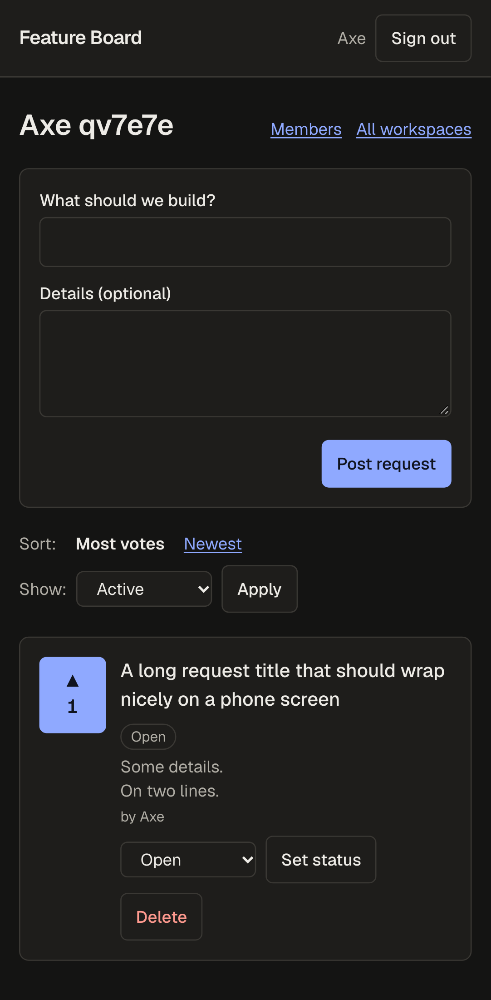

# feature-board

A small multi-tenant SaaS on the **Next.js 16 App Router**: teams get a private board, members post feature requests and vote, admins move requests through *planned → in progress → done*, and people join through single-use invite links.

It exists to show the parts of a Next.js product that usually go wrong: hand-rolled session auth, authorization inside every Server Action, tenant isolation, and Cache Components (partial prerendering) with per-user data.



## What it does

- **Accounts**: sign up, sign in, sign out. Passwords hashed with scrypt (`N=2^17, r=8, p=1`), per-hash salt, constant-time compare.
- **Sessions**: a random 256-bit token in an `httpOnly`, `SameSite=Lax`, `Secure` cookie. The database stores only its SHA-256, so a leaked `sessions` table cannot be replayed. 30-day sliding expiry; sign-out deletes the row, so a copied cookie dies too.
- **Workspaces** with roles `owner > admin > member`. Owners can do everything; admins invite and manage members but cannot touch owners; the last owner can never be demoted or leave.
- **Invites**: single-use, 7-day links. Only the hash is stored; the link is shown once.
- **Requests**: post, vote (optimistic UI), filter by status, sort by votes or date. Admins set status; authors may delete their own request until someone else has voted.

## Design decisions

| Decision | Why |
|---|---|
| **Core logic in plain functions** (`src/server/core/*`) that take a database handle and the caller's membership | The same rules are tested directly against a real Postgres, without Next.js, and the Server Actions stay thin. |
| **Every Server Action re-checks the session and role** (`src/app/actions.ts`) | A Server Action is a public POST endpoint. Hiding a button is not authorization. The tests call actions directly, the way a forged request would. |
| **Non-members get 404, not 403** | A private workspace's slug cannot be probed. Request IDs from another workspace are also "not found". |
| **Votes set a wanted state, not "toggle"** | `setVote(id, true)` twice counts once. With a `(request_id, user_id)` primary key, double clicks and racing tabs cannot double count. |
| **Invite acceptance is one `UPDATE … WHERE used_at IS NULL … RETURNING`** inside a transaction | Single use holds even when two people accept at the same moment (tested with 3 concurrent accepts). |
| **Same error for unknown email and wrong password**, and an unknown email still pays for a hash | No account enumeration by message or timing. 5 failures per email in 15 minutes locks that email. |
| **`safeNext()` for post-login redirects** | Blocks `https://…`, `//evil`, `/\evil` and control characters (open redirect). |
| **`proxy.ts` (formerly middleware) does optimistic checks only** | It redirects when there is no cookie and refreshes the cookie's max-age. The real check (hash lookup, expiry, membership) lives in the Data Access Layer (`src/server/session.ts`), per the Next.js guidance. |
| **Cache Components on** | The landing page, headers and form shells prerender as static HTML; anything that reads the session streams in behind `<Suspense>`. Session and invite checks call `connection()` first, because they compare against the clock and must never be prerendered. |
| **PGlite** (Postgres compiled to WASM) as the database | Real Postgres semantics (transactions, `ON CONFLICT`, `FOR UPDATE`, identity columns) with no server to install. Swapping to a hosted Postgres means replacing `openDb()`; the SQL is plain Postgres. |
| **Invite links built on the client from `window.location.origin`** | The server returns only a path, so a spoofed `Host` header cannot poison an invite link. Invite pages send `Referrer-Policy: no-referrer`. |

## Run it

```bash
npm install
npm run dev          # http://localhost:3000, data in .data/pglite
```

Set `DATABASE_DIR` to put the database elsewhere. There are no API keys or external services.

## How it was tested

```bash
npm test             # 63 Vitest tests (core + Server Actions), ~1 s
npm run test:e2e     # 16 Playwright runs: 8 specs x (Desktop Chrome, Pixel 7)
npm run lint && npm run typecheck
```

- **Core tests** run against a real in-memory Postgres (PGlite): password hashing, session expiry and sliding renewal, lockout window, tenant isolation for every request operation, role rules, single-use invites under concurrency, idempotent votes under concurrency.
- **Server Action tests** import `src/app/actions.ts` with `next/headers`, `next/cache` and `next/navigation` replaced by small fakes, then call actions as an attacker would: no session, a revoked cookie, a member calling admin actions, a member of workspace A passing a request id from workspace B. Unexpected errors are checked not to leak internals.
- **End-to-end** against a production build (`next build && next start`) with a throwaway database: sign-up validation, redirect back after login, cookie flags, optimistic voting surviving a reload, status filters, the full invite flow in two browser contexts, 404 parity for real vs. made-up slugs, security headers, and an axe WCAG 2 A/AA scan plus a no-horizontal-overflow check in light and dark mode on desktop and phone.
- **Mutation check**: 13 deliberate breakages (cross-tenant lookup, skipped password check, `//` open redirect, reusable invite, status not admin-only, action dropping the role check, ignored session expiry, demotable last owner, lockout off, leaking error messages, non-idempotent vote, cookie without `httpOnly`, missing `revalidatePath`). All 13 were caught; the last one only by the Server Action unit test, not by e2e.
- Bugs the tests found while building: `ORDER BY created_at` gave an unstable "newest" order when two requests landed in the same millisecond (fixed with an identity column), and Next.js refused to prerender the session check because it reads the clock (fixed with `connection()`).

CI (`.github/workflows/ci.yml`) runs lint, typecheck, unit tests and build on Node 22.18 and 24, and the Playwright suite on Node 24.

## Honest limits

- **Not deployed.** The test numbers above come from local runs on macOS; GitHub Actions also passes (Node 22.18 + 24, and Playwright on Ubuntu).
- **PGlite is single-process.** Fine for a demo and for tests; a real deployment needs a hosted Postgres (Neon, Supabase, RDS) and a shared rate-limit store. The login lockout is per email only; there is no per-IP limit, so one attacker can lock a victim's email for 15 minutes.
- **No email**: no verification, password reset or invite emails. Invites are links you copy.
- **No CSRF token**: it relies on Next.js's Origin/Host check for Server Actions plus `SameSite=Lax` cookies.
- No audit log, no pagination beyond 200 requests per view, no comments on requests.
- Tested in Chromium only (desktop and Pixel 7 emulation), not with a screen reader.

## Layout

```
src/
  proxy.ts                 optimistic auth redirect + cookie refresh
  server/
    schema.sql             tables, constraints, indexes
    core/                  framework-free logic + tests (accounts, workspaces, requests)
    session.ts             Data Access Layer: cookie → user, membership → 404
    form-state.ts          what actions return to useActionState
  app/
    actions.ts             all Server Actions (+ actions.test.ts)
    w/[slug]/…             board and members pages
  components/              forms (useActionState), optimistic vote button
e2e/                       Playwright specs
```
